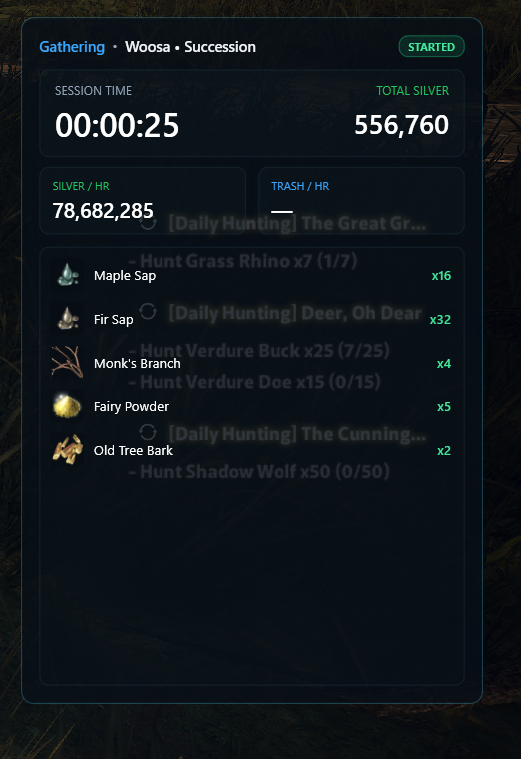
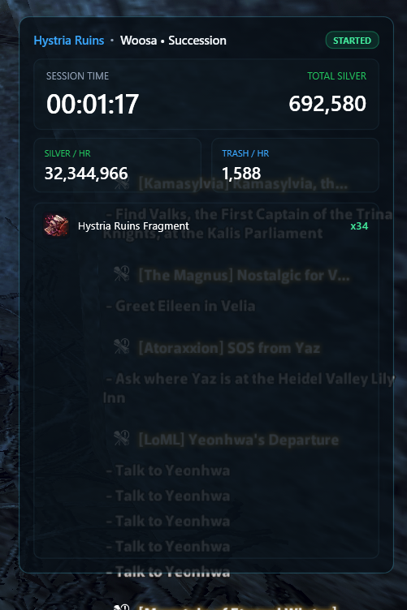

# BDO Loot Tracker

A Windows desktop loot tracker for **Black Desert Online**. BDO Loot Tracker uses **Npcap** to passively read the relevant incoming game traffic and track loot in real time without OCR for normal grind sessions.

[Download the latest release](https://github.com/Shoki697/BDOLootTracker/releases)

## Highlights

- Real-time packet-based loot tracking
- Automatic grind-spot detection
- Dedicated **Gathering** packet support
- Searchable manual Garmoth spot selection for sessions and uploads
- Silver/hr and Trash/hr statistics
- Detailed and compact in-game overlay
- Session history with shareable screenshots
- Garmoth Grind Tracker upload with review/edit step
- Optional **Garmoth-only loot filter** and Ignore List
- Manual parser calibration + community parser recovery after BDO patches
- ExitLag compatibility mode
- EU / NA / MENA loot and price regions
- Global keybinds, pause/resume, system-tray mode and automatic updates

## Requirements

- Windows 10/11 x64
- [Npcap](https://npcap.com/) installed

Npcap is required for packet capture. The capture path is read-only; BDO Loot Tracker does not inject or modify game traffic.

## Installation

1. Download the latest `BDOLootTracker-win-Setup.exe` from GitHub Releases.
2. Install Npcap if it is not already installed.
3. Start BDO Loot Tracker.
4. Open **Settings → Network** and select the network adapter used by BDO.
5. Open **Settings → Database & Loot**, select the correct region/language, then run **Fetch / Update Database**.
6. Press **START** before grinding or gathering.

### Updating from v0.12.7

After updating to **v0.13.0**, run **Settings → Database & Loot → Fetch / Update Database** once. Gathering packet detection itself does not depend on the Garmoth spot database, but refreshing ensures the newest item metadata, prices and complete spot list are available for manual spot selection and Garmoth upload.

## Grind tracking

Normal monster loot uses the calibrated Ground Loot parser. The tracker can automatically identify supported grind spots from the Garmoth spot/drop mapping and shows the detected spot in the main window and overlay.

If BDO changes the packet layout after weekly maintenance, use **Settings → Network → Manual Calibration**. A successful local calibration can be activated immediately and, when appropriate, submitted to the built-in Community Parser service.

## Gathering tracking

Gathering uses a **separate packet family** from normal ground loot. The tracker detects the gathering result packet directly and labels the session simply as **Gathering** instead of trying to guess an exact gathering location from shared materials.

The exact Garmoth gathering spot can be selected later from the searchable spot picker in **Session History** or directly in the **Garmoth Upload** window.

## Grind-spot detection

For normal grinding, the tracker still performs automatic spot detection. Older spots such as Hystria Ruins use the same detection flow as current grind spots.

## Garmoth integration

Add your Garmoth API token under **Settings → Garmoth**. Completed sessions can be uploaded from the main window or Session History.

Before upload, the review window lets you:

- review tracked loot and quantities;
- choose/correct the exact Garmoth spot with a searchable selector;
- reuse the saved session Drop Rate metadata;
- keep the original packet-tracked session unchanged while adjusting upload quantities.

For auto-detected **Gathering** sessions, choosing the exact Garmoth gathering spot before upload is intentional.

## Garmoth-only loot filter

**Show and track only loot items known by Garmoth** remains available in Settings. It filters the normal live loot list, but it does **not** participate in Manual Calibration.

Confirmed Gathering result packets are also allowed through independently, so Gathering support is not dependent on Garmoth having a perfect item-to-spot mapping.

## Session History

Sessions are stored locally and can be reviewed by spot. Session History supports:

- expandable loot details;
- Silver/hr and Trash/hr summaries;
- searchable manual spot assignment;
- Garmoth upload status;
- Drop Rate metadata;
- shareable session screenshots;
- Ignore List management for unwanted items.

## Overlay

The optional overlay can stay visible over BDO and supports:

- Detailed / Compact layouts
- opacity control
- configurable maximum item count
- sorting by quantity, time, total value or unit value
- position reset and saved placement
- global show/hide hotkey

## Network / parser recovery

Under **Settings → Network** you can see Npcap status, capture diagnostics and the currently active parser profile.

Useful recovery tools include:

- **Check for Parser Update**
- **Manual Calibration**
- **Roll Back** to the last-known-good parser
- optional **ExitLag compatibility mode**

The parser/calibration system is intentionally separated from Garmoth filtering and spot detection so a spot-database change cannot break packet calibration.

## Reporting problems

When reporting a loot-detection issue, the most useful information is:

- BDO region
- whether ExitLag is enabled
- active parser version/signature from **Settings → Network**
- the affected grind/gathering spot
- a screenshot of the Network diagnostics
- a short Wireshark `.pcapng` capture if the packet format appears to have changed

Please use the [GitHub Issues](https://github.com/Shoki697/BDOLootTracker/issues) page for bug reports and feature requests.

---

## Market Tax

Under **Settings → Character**, BDO Loot Tracker can estimate Central Market collection value using Value Pack, Rich Merchant's Ring and Family Fame bonuses. Tax adjustment is optional and affects only local session totals / Silver per hour for non-trash market loot. Trash/vendor loot stays untaxed, and Garmoth uploads keep the original raw loot values. Taxed sessions are marked with a small **TAXED** badge in Session History, screenshots and the overlay.
